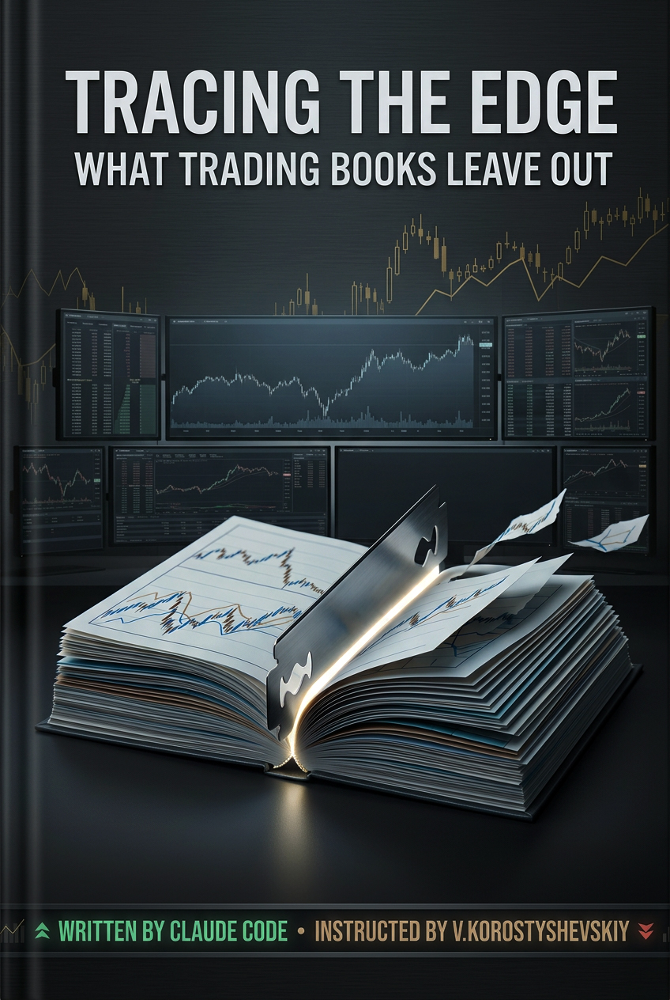

# Tracing the Edge

**What Trading Books Leave Out**

A search through the public record for the one thing every trading source leaves out: the edge, where it comes from, and how it survives. 14 chapters across four parts, roughly 92,000 words of body text, 29 glossary terms, and 168 endnotes.

The editorial position is this: trading books teach you what to buy, when to buy it, and where to place your stop. The one thing consistently absent, across hundreds of sources and thousands of pages, is the reason any of it should work. Not the pattern. Not the setup. The mechanism underneath: a repeatable, positive-expectancy decision, a source of persistence that keeps it alive, and someone on the other side of every fill who keeps accepting a worse price because something in the structure of the market compels them to. That mechanism is the edge. This book is organized around finding it.

[Video overview of the project](https://www.youtube.com/watch?v=B4xxF4OWH9M)

## Where the material comes from

Nothing in this book comes from me.

Not a strategy I used, not a conversation I had, not anything I observed anywhere. There is no private material in this text and no personal experience being sold to you as insight. All of it was assembled out of published sources.

That is checkable, which is the point. Every empirical claim traces to a numbered citation in [`ENDNOTES.md`](./book/ENDNOTES.md), and every citation points to a published book, a public video, or a peer-reviewed paper. Anything the book asserts beyond its sources is confined to blocks marked **Reconstruction**, which are its own conjecture about mechanism and are labeled as such wherever they appear. There is no third layer. If a claim in this book is true, someone else established it first, and the endnote will tell you who.

## Why I wrote it

I wrote this for myself, first.

I wanted to know what people are actually doing out there. Which strategies work, why they work, what has to be true for them to keep working, and what you need to know to execute one. I wanted to find the gaps in my own understanding and close them. So I built a corpus, set the sourcing rules, and had the material assembled into something I could read end to end.

Somewhere in the middle of reading it, it became clear that the thing I had built for my own use might be worth reading for anyone in the same position. So it is here.

## Why this exists

Every edge has a lifecycle. Discovered, exploited, crowded, compressed. Publish a statistical predictor of stock returns and roughly 58% of the alpha does not survive post-publication. The majority of the in-sample return is gone before the next cohort of researchers runs the replication. Some of that is statistical artifact. The rest is competition: quantitative desks that read the paper, implemented the signal, and traded against it until the mispricing closed.

That decay is a fact. It is also not the whole story. Some edges survive publication because the counterparty on the other side cannot stop losing. An index fund cannot refuse additions to the index. A hedger cannot stop purchasing insurance. A retail trader governed by loss aversion cannot stop holding the position that should have been closed three weeks ago. The constraint is what makes the pattern repeatable. It is what gives the edge its shelf life.

This book traces both sides of that dynamic: the edges that collapse the moment they become known, and the ones that persist because the structural reason behind them is not going anywhere.

## What it covers

Trading literature is split into two halves that do not read each other. The research on risk premia and return predictability does not acknowledge that a large population is learning to trade from video instruction. The material written for that population does not engage with the research on whether its patterns survive being published. Each side treats the other as noise.

This book covers both, in one volume, graded on the same scale. Published books, peer-reviewed papers, and public video instruction, sorted not by technique or asset class but by mechanism: who is on the other side of the trade, why they cannot stop taking it, and whether the edge held up once it was written down. A retail breakout method and an academic factor premium get the same treatment and the same evidence grade.

No chapter goes deep. That is deliberate. What is on offer is the whole surface in a single volume, so you can see what exists, see how each piece relates to the rest, and then go as far down as you want into whichever part earned your attention. Depth is available everywhere already. The map is not.

## Who should read it

If you already know what you are buying and selling and when, you do not need this book. You should be trading.

This is for the reader who does not know yet. The one who can name a dozen strategies but could not say which of them still work, or why any of them worked in the first place, or who was on the losing side of the trade.

I will not claim you will be able to trade after reading it. That is not a promise a book can keep, and this book argues against the idea. The claim is narrower and, I think, more useful: you will hold the vocabulary, and you will have a map of the publicly documented ways people extract money from markets, including which of those survived being written down and which did not. You should be able to hold a conversation about any of it with anyone. Most people who talk about trading cannot.

## What reading it costs

It is long and it is dense. Roughly 92,000 words, four parts, no filler chapters. I expect some grit from anyone who takes it on.

The prose was written to be readable. It is sourced narrative, not a textbook, and the aim throughout was to season the text rather than drown it. Where a case is genuinely interesting, the writing lets it be interesting. Where a claim is thin, the register goes flat on purpose, because dramatizing weak evidence is exactly the failure this book was built to avoid.

I do not expect many readers. If it helps ten people understand what they are actually looking at, or recognize a strategy that cannot work before they fund it, putting it in public was worth the effort.

## How each case is presented

Two layers. Visibly separated.

The first is a faithful rendering of what the public source described: the strategy, the parameters, the documented outcomes. Read that layer as reported fact and nothing more.

The second is marked **Reconstruction** and contains the book's own conjecture about the underlying mechanism. This is analytical interpretation, not a position any cited source stated. Weigh it as conjecture, checked against the faithful layer above it and the cited evidence.

Evidence quality is noted for every case: backtested, tested out of sample, live traded, asserted by the author, or self-reported without documentation, in descending order of weight. Each case also carries a durability label signaling how the edge has held up over time.

## Structure

14 chapters across four parts, plus a [Preface](./book/chapters/00-preface.md):

**Part I: The Build.** Edges rooted in private knowledge and in quantitative models.
- [Ch 1: What Is an Edge?](./book/chapters/01-what-is-an-edge.md)
- [Ch 2: The Knowledge Edge](./book/chapters/02-the-knowledge-edge.md)
- [Ch 3: Models and Machines](./book/chapters/03-models-and-machines.md)

**Part II: The Behavioral.** Five strategy families sorted by the psychological flaw each one exploits.
- [Ch 4: Breakout Patterns](./book/chapters/04-breakout-patterns.md)
- [Ch 5: Riding the Wave](./book/chapters/05-riding-the-wave.md)
- [Ch 6: Fading the Extreme](./book/chapters/06-fading-the-extreme.md)
- [Ch 7: The Shrinking Premium](./book/chapters/07-the-shrinking-premium.md)
- [Ch 8: When News Moves Price](./book/chapters/08-when-news-moves-price.md)

**Part III: The Structural.** Edges from plumbing, not psychology. The counterparty is obeying a mandate, not making a mistake.
- [Ch 9: Forced Flows and Calendar Ghosts](./book/chapters/09-forced-flows-and-calendar-ghosts.md)
- [Ch 10: The Return for Standing Still](./book/chapters/10-the-return-for-standing-still.md)
- [Ch 11: Selling Insurance](./book/chapters/11-selling-insurance.md)
- [Ch 12: Reading the Tape](./book/chapters/12-reading-the-tape.md)

**Part IV: Arrival.** Risk management and the question every trader eventually faces.
- [Ch 13: Sizing, Stops, and Survival](./book/chapters/13-sizing-stops-and-survival.md)
- [Ch 14: What Survives](./book/chapters/14-what-survives.md)

Chapters are self-contained within their part. [`GLOSSARY.md`](./book/GLOSSARY.md) collects every bolded term with a short definition. [`ENDNOTES.md`](./book/ENDNOTES.md) contains 168 source citations organized by chapter.

## What's in this repo

- `README.md`: this file.
- [`book/Tracing-The-Edge.pdf`](./book/Tracing-The-Edge.pdf): PDF for offline reading and print.
- [`book/Tracing-The-Edge.epub`](./book/Tracing-The-Edge.epub): EPUB for e-readers.
- [`book/chapters/`](./book/chapters/): the 14 chapters, preface, and part dividers as individual Markdown files, with superscript endnote markers.
- [`book/GLOSSARY.md`](./book/GLOSSARY.md): 29 terms with definitions.
- [`book/ENDNOTES.md`](./book/ENDNOTES.md): 168 source citations organized by chapter, drawn from published books, public video instruction, and peer-reviewed financial research.

The source corpus, extracted claims, consolidated reference documents, and pipeline scripts are not published. Only the book and the description of the approach are here.

## Coverage cutoff

The corpus spans publications through Q2 2026. Nothing published after that date is reflected. Markets move fast.

## AI assistance, scope of

Claude was used for corpus processing (claim extraction, consolidation, cross-referencing), prose generation in a defined voice, per-chapter assembly under explicit instructions, fact-tracing, and glossary generation. Editorial decisions about which sources to include, how to organize the material, and what to emphasize were mine. No independent fact-checking or source verification beyond what is already in the corpus was performed. The pipeline enforces that every claim traces to a source; it does not verify the source against primary data.

## What this book is not

This book is not investment advice. It is not a trading manual, a strategy recommendation, or a substitute for a financial advisor who knows your situation. It is a structured, sourced, and graded account of the trading edges that exist in the public record, documented by how they work, who loses on the other side, and whether they survive being known. Do not place trades based on anything you read here without consulting a qualified professional.

## Author

This book is not written on my authority, and nothing in it rests on my judgment about markets. Every empirical claim belongs to someone who published it, or to someone contesting them.

What I did was the part that was mine to do: build the corpus, define the sourcing rules, and hold the assembly to them so that nothing entered the text without an owner. Keeping the attribution intact and the grading honest was the whole job.

## License

This repository is published for personal reading only. See [LICENSE](./LICENSE) for full terms. Commercial reproduction, redistribution, and use as AI training data are not permitted.

---

